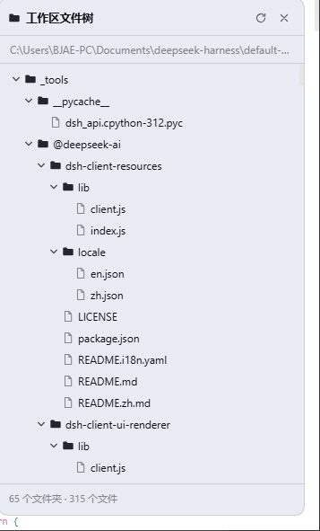
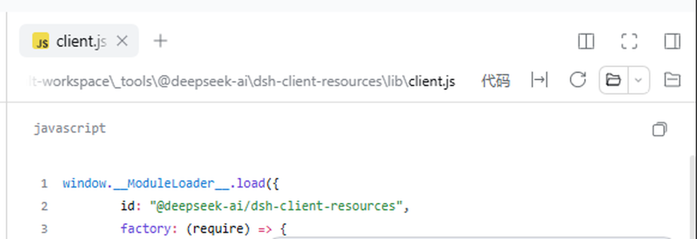

# dsh-workspace-files-tree

**DSH 工作区文件树** — DeepSeek Harness Web GUI 插件：把当前工作区的全部文件/文件夹以树状结构浮层展示，并支持**双击文件直接在 DSH 查看器中打开**（占用右侧窗口，像查看代码一样查看内容）。

在 **DeepSeek Harness 0.2.2-rc.1**（Windows 桌面版）上开发并实测通过。

| 工作区文件树 | 双击文件在查看器中打开 |
| --- | --- |
|  |  |

## 功能

- 递归读取**当前会话工作区**的全部目录层级（通过 DSH 既有的 `workspaceFiles` Remote，不额外申请目录权限），目录优先、名称自然排序，默认全部展开。
- 浮层面板：展开/折叠目录、刷新、关闭（收起为右下角文件夹按钮）、页脚显示 `N 个文件夹 · M 个文件`；跟随主视图会话/工作区切换。
- **双击文件**（或聚焦后按 Enter）→ 构建 `dsh-resource://file/session/<sessionId>/<path>` 地址 → 调用 `ctx.sidebarRight.openResource(...)`，在右侧 Sidebar 查看器中打开。DSH 能查看的文件都走这条路径：文本/代码、Markdown、图片、PDF、HTML、表格；Word/PPT 由 DSH 本地转 PDF；未知扩展名按纯文本；确实无法预览的二进制文件会显示 DSH 自带的不支持提示。
- 中英双语（界面 + 插件管理器标题/描述），原创图标；样式只使用 `--dsw-alias-*` 主题变量，自动适配亮/暗主题。
- 安全上限：最多 4000 个节点、12 层目录（超出时在页脚提示）；单目录条目数受 DSH 自身上限约束。
- 纯浏览器 UI：Host 半侧为空实现，不注册工具、不发起网络请求、不申请额外权限。

## 安装（安装插件形式）

前置：DSH 0.2.1+ 的 Web/桌面 profile（插件依赖 `sidebarRight` 与文档预览插件，默认 profile 均已包含）。

### 方式一：Web GUI「添加插件」（推荐）

1. 打开 DSH Web GUI，左侧 **插件** → 右上 **「添加插件」**（或箭头菜单「安装第三方插件」）。
2. 在包字段中填入以下任一种：
   - **Git 地址**：`https://github.com/xxw-cell/dsh-workspace-files-tree.git`
   - **Release 压缩包 URL**（见 [Releases](https://github.com/xxw-cell/dsh-workspace-files-tree/releases)）：`https://github.com/xxw-cell/dsh-workspace-files-tree/releases/download/v1.0.0/dsh-workspace-files-tree-1.0.0.tgz`
   - 已下载的 `.tgz` 的本地绝对路径
3. 确认安装。GitHub 访问受限时，对话框会提示改用镜像/重试；也可以直接下载 Release 的 `.tgz` 后用本地路径安装。
4. 安装成功后 bundle 默认启用，右下角出现 **文件夹按钮**，点击展开文件树。

> 安装对话框接受：带可选版本的包名、Git 地址、tarball URL 或本地绝对路径（与 `dsh plugin add` 接受的 spec 相同）。

### 方式二：agent / plugin_manager 工具

对 DSH agent 说「安装 https://github.com/xxw-cell/dsh-workspace-files-tree.git 这个插件」，或直接调用：

```jsonc
// plugin_manager
{ "action": "install_bundle", "target": "https://github.com/xxw-cell/dsh-workspace-files-tree.git" }
```

### 方式三：本地开发安装（link）

```jsonc
{ "action": "install_bundle", "target": "<本仓库克隆目录的绝对路径>" }
```

本地目录以 `link:` 依赖安装，修改源码后重新载入即可调试。

## 使用

- 点右下角文件夹按钮展开面板；点面板右上角刷新/关闭。
- **双击文件** → 右侧查看器打开文件；单击目录行展开/折叠。
- 文件行悬停会显示完整路径和「双击打开」提示；聚焦文件行后按 Enter 同样可打开。
- 面板开合状态会记忆在本地；禁用插件后浮层与按钮都会消失，重新启用后恢复。

## 启用 / 关闭

- Web GUI 左侧 **插件** 页 → 找到 **工作区文件树 / Workspace File Tree** → 切换 bundle 或 `workspace-files-tree` 行。
- 或命令行/tool：`plugin_manager` 的 `set_bundle` / `set_plugin`（entryId `include:workspace-files-tree`）。
- 设置写入当前 profile，跨会话生效；运行中的页面通过 DSH HMR 实时热启用/关闭。

## 兼容性

- 开发验证版本：DSH **0.2.2-rc.1**（桌面版，Windows）。0.2.1-rc.3 起包含相同 `sidebarRight`/`documentpreview` API 的版本应可用。
- 依赖的 Host 服务：`workspaceFiles`（工作区目录读取）、`sessions`/`uiWorkspace`（当前会话与工作区）、`sidebarRight`（打开查看器）。
- 只依赖浏览器端共享模块 `react`，不引入其它 Harness Client 包。

## 已知限制

- 只显示**当前选中会话**的工作区；不提供搜索、过滤、拖拽、右键菜单、文件操作。
- 树读取是一次性快照；文件变化后点刷新重新读取。
- 超大工作区会命中 4000 项 / 12 层上限并在页脚提示。
- 物理双击依赖浏览器事件；本插件不模拟点击，打开动作与内置「文件」树一致。

## 开发与发布

```text
package.json        插件/组合包清单（dsh.bundle.patch + dsh.client）
cordis.patch.yml    插入 workspace-files-tree 一行
index.js            Host 半侧（空实现）
client.js           浏览器端：树浮层 + 双击打开查看器
locale/en|zh.json   插件管理器展示用标题/描述
icon.svg            插件图标
docs/               README 截图
.github/workflows/  Release 构建（打 tag 时 npm pack 并上传 .tgz）
```

发布：`git tag v1.0.0 && git push origin v1.0.0`，GitHub Actions 会把 `npm pack` 生成的 `.tgz` 附加到对应 Release；安装对话框可直接填该 `.tgz` URL。

## License

[MIT](LICENSE)
